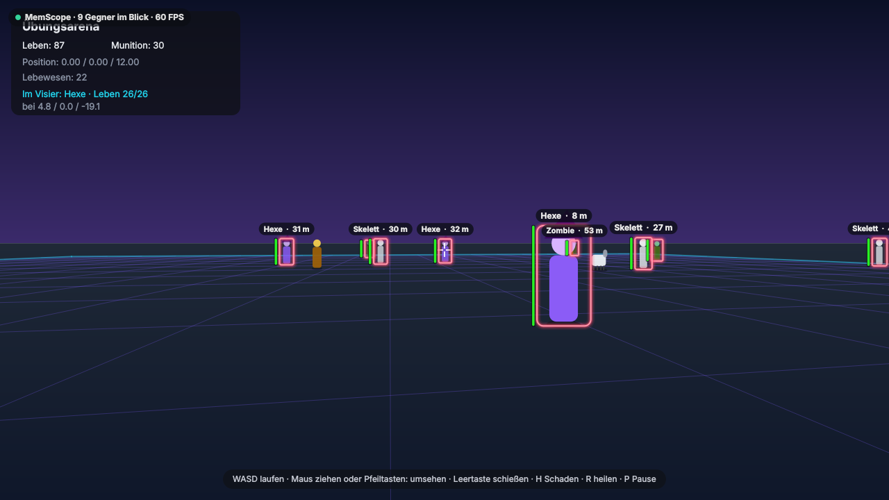
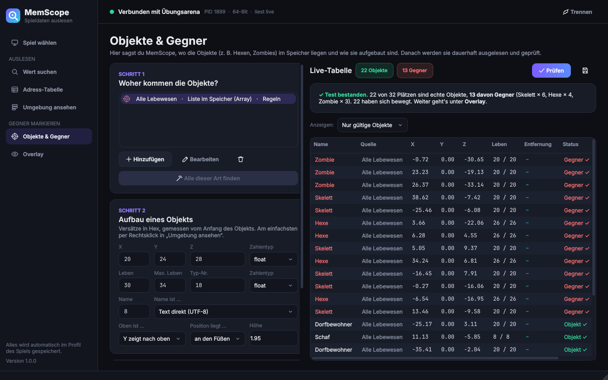
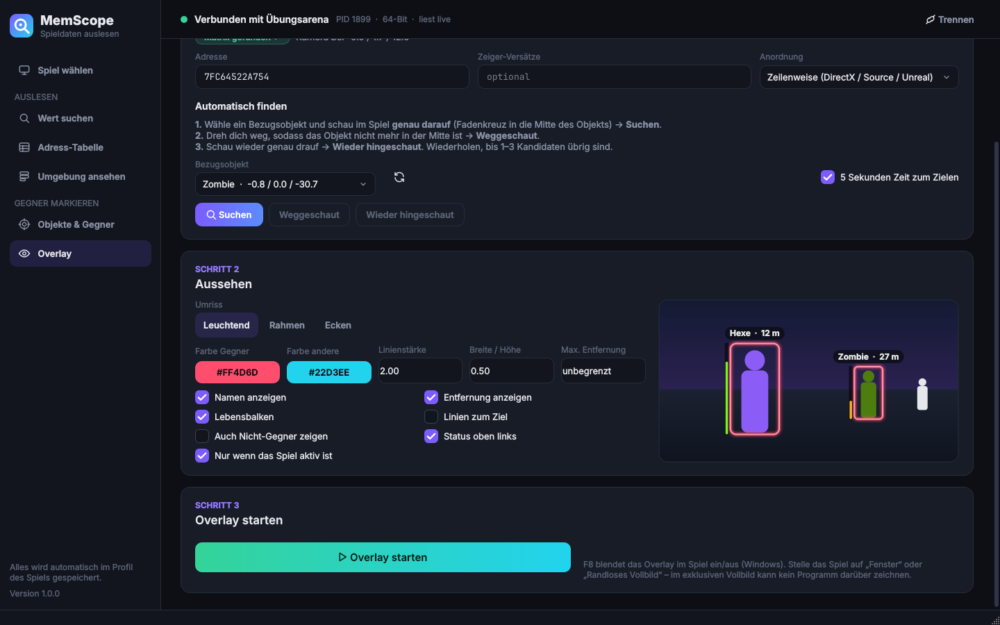

# MemScope

MemScope liest Daten aus einem laufenden Spiel aus, zum Beispiel Leben, Munition
oder die Position von Gegnern. Alles, was du findest, landet in einer Tabelle und
wird dauerhaft live gelesen. Erkannte Gegner (zum Beispiel eine Hexe) markiert
MemScope mit einem leuchtenden Umriss direkt im Bild des Spiels.

MemScope funktioniert nicht nur mit Minecraft, sondern mit vielen Spielen.
Es **liest nur**: Am Spiel wird nichts verändert.



| Objekte & Gegner | Overlay einstellen |
| --- | --- |
|  |  |

> **Wichtig:** Benutze MemScope nur im Einzelspieler, im Offline-Modus oder auf
> deinem eigenen Server. Online-Spiele mit Anti-Cheat (Easy Anti-Cheat, BattlEye,
> Vanguard, FACEIT …) erkennen solche Programme. Dann wird dein Konto gesperrt.
> MemScope warnt dich, wenn es ein Anti-Cheat-Programm sieht.

---

## Starten (Windows)

1. Installiere **Python 3.10 oder neuer** von <https://www.python.org/downloads/>.
   Setze bei der Installation den Haken bei **„Add python.exe to PATH“**.
2. Doppelklick auf **`start.bat`**.
   Beim ersten Mal installiert sich alles von selbst. Das dauert ein bis zwei Minuten.
3. Fertig. MemScope fragt dich jetzt: **„Welches Spiel soll ausgelesen werden?“**

Wenn das Spiel als Administrator läuft, musst du MemScope auch als Administrator
starten: Rechtsklick auf `start.bat` → **„Als Administrator ausführen“**.

Auf Linux geht es mit `./start.sh`.

---

## So funktioniert es – in 5 Schritten

Am besten probierst du alles zuerst mit der **Übungsarena** aus. Das ist ein kleines
3D-Spiel mit Hexen, Zombies, Skeletten, Schafen und Dorfbewohnern. Dort kann nichts
kaputtgehen. Klicke im Startbildschirm auf **„Übungsarena starten“**.
MemScope verbindet sich dann automatisch.

In der Arena: **WASD** laufen · **Maus ziehen** oder **Pfeiltasten** umsehen ·
**Leertaste** schießen · **H** Schaden nehmen · **R** heilen · **P** Pause.

### 1. Spiel wählen

Starte das Spiel. Wähle es dann in MemScope aus der Liste und klicke **„Verbinden“**.
Für jedes Spiel legt MemScope ein eigenes **Profil** an. Beim nächsten Mal ist alles
schon wieder da.

### 2. Wert suchen

So findest du heraus, wo ein Wert im Speicher steht:

1. Lies den Wert im Spiel ab, zum Beispiel **Leben: 100**.
2. Gib `100` ein und klicke **„Erste Suche“**. Es gibt jetzt sehr viele Treffer.
3. Ändere den Wert im Spiel (in der Arena: Taste **H**). Jetzt steht da zum Beispiel **87**.
4. Gib `87` ein und klicke **„Weiter eingrenzen“**.
5. Wiederhole das, bis nur noch ein Treffer übrig ist.
6. Doppelklick auf den Treffer → er landet in der **Adress-Tabelle**.

Tipps:
- Leben ist oft eine **Kommazahl (float)**, Munition meistens eine **Ganzzahl**.
- Kennst du den Wert nicht genau (zum Beispiel eine Position)? Dann nimm
  **„Unbekannter Startwert“** und danach **„Größer geworden“** oder **„Kleiner geworden“**.

### 3. Adress-Tabelle

Hier stehen alle gefundenen Adressen. Die Werte werden **dauerhaft live** ausgelesen.
Die Spalte **„Nach Neustart“** zeigt dir, ob eine Adresse nach einem Neustart des Spiels
noch stimmt:

- **bleibt gleich** (grün): Die Adresse hängt am Spiel-Programm. Sie stimmt auch morgen noch.
- **ändert sich** (gelb): Die Adresse ist nur für jetzt gültig.
  Mit **„Zeiger suchen“** findest du oft eine Adresse, die gleich bleibt.

### 4. Objekte und Gegner

Ein Gegner ist im Speicher ein **Block aus Zahlen**: Position (X, Y, Z), Leben, Name …
Diese Werte liegen immer an derselben Stelle im Block.

1. Suche das **Leben eines Gegners** (in der Arena: Gegner anvisieren und schießen,
   dann „Kleiner geworden“).
2. Klicke **„Umgebung ansehen“**. Du siehst den Speicher rund um den Wert.
   Werte, die sich gerade ändern, leuchten gelb.
3. **Rechtsklick** auf eine Zeile → „als X-Position verwenden“, „als Leben verwenden“,
   „als Name verwenden“ … und „Hier beginnt das Objekt“.
4. Wechsle zu **„Objekte & Gegner“**. Dein Objekt steht jetzt in der Liste.
5. Klicke **„Alle dieser Art finden“**. MemScope sucht dann automatisch alle Objekte
   derselben Art (zum Beispiel alle Hexen). Das klappt über den „Klassen-Zeiger“ am
   Anfang jedes Objekts.
6. Klicke **„Prüfen“**. MemScope liest zwei Sekunden lang mehrmals und sagt dir, ob es
   wirklich Objekte sind und wie viele davon Gegner sind.

Was ein **Gegner** ist, stellst du selbst ein: entweder „Alle sind Gegner“ oder über
Namen (zum Beispiel `hexe, witch, zombie`) oder Typ-Nummern.

### 5. Overlay

Das Overlay ist ein durchsichtiges Fenster über dem Spiel. Es zeichnet Umrisse um
die Gegner. Dafür braucht MemScope die **Kamera-Matrix**. Das sind 16 Zahlen, die
sagen, wohin du gerade schaust. MemScope findet sie für dich:

1. Wähle ein **Bezugsobjekt** (zum Beispiel eine Hexe).
2. Klicke **„Suchen“**. Du hast 5 Sekunden Zeit. Wechsle ins Spiel und schau
   **genau** auf das Objekt (Fadenkreuz in die Mitte).
3. Klicke **„Weggeschaut“** und dreh dich im Spiel vom Objekt weg.
4. Klicke **„Wieder hingeschaut“** und schau wieder genau drauf.
5. Jetzt sind meistens nur noch 1–3 Kandidaten übrig. Klicke **„Kandidat übernehmen“**.
6. Klicke **„Overlay starten“**. Fertig – die Gegner sind jetzt dauerhaft markiert.

Mit **F8** blendest du das Overlay im Spiel ein und aus. Aussehen (Leuchtend, Rahmen,
Ecken), Farben, Namen, Entfernung und Lebensbalken kannst du einstellen.

---

## Gut zu wissen

- **Vollbild:** Stelle das Spiel auf **„Fenster“** oder **„Randloses Vollbild“**.
  Im exklusiven Vollbild kann kein Programm über das Spiel zeichnen.
- **Nach Spiel-Updates** stimmen gespeicherte Adressen oft nicht mehr. Dann musst du
  sie neu suchen.
- **Nicht jedes Spiel klappt.** Jedes Spiel speichert seine Daten anders. MemScope
  hilft beim Suchen, aber du musst die Werte selbst finden.
- **Minecraft (Java Edition)** ist besonders schwer: Java verschiebt seine Daten
  ständig im Speicher, Positionen sind `double`-Zahlen, und Minecraft rechnet die
  Kamera anders als die meisten Spiele. Für Minecraft im Einzelspieler gibt es einen
  viel einfacheren Weg, Hexen mit Umriss anzuzeigen – den eingebauten Leuchten-Effekt:
  `/effect give @e[type=witch] minecraft:glowing infinite 0 true`
- **Spiele mit Anti-Cheat** blockieren das Auslesen oder sperren dein Konto.
  MemScope enthält absichtlich **keine** Tricks, um Anti-Cheat zu umgehen.

## Wo wird was gespeichert?

Jedes Spiel bekommt eine Datei in `profile/<programmname>.json`. Darin stehen deine
Adress-Tabelle, der Aufbau der Objekte, die Kamera-Matrix und das Aussehen des Overlays.
Tabellen kannst du zusätzlich als **CSV** (für Excel) speichern.

## Für Entwickler

```text
memscope/
  backend/        Speicher lesen: windows.py (ReadProcessMemory), linux.py (/proc)
  scanner.py      Wertesuche (Erste Suche, Weiter eingrenzen)
  address.py      Adressen wie spiel.exe+1A2B und Zeigerketten
  pointers.py     "Zeiger suchen"
  entities.py     Objekte lesen, prüfen, Gegner erkennen, Klassen-Suche
  projection.py   Welt → Bildschirm, Kamera-Matrix finden
  profile.py      Profile pro Spiel (JSON) und CSV-Export
  session.py      Verbindung + Profil, von allen Seiten geteilt
  ui/             Oberfläche (PySide6): Seiten, Overlay-Fenster, Design
  demo/arena.py   Übungsarena
tests/            Tests gegen die Übungsarena (pytest)
```

Tests ausführen:

```bash
pip install -r requirements.txt pytest
python -m pytest tests
```
